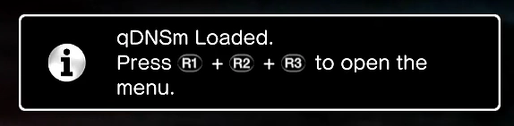

# qDNSm

A quick DNS switcher for the PlayStation 3. Change the DNS server you are using on your PS3 directly through the XMB within seconds.

Pick a DNS server from a list and qDNSm writes it into the console's network
configuration. By default it also restarts the Internet Connection so the new DNS
takes effect immediately. It runs as a VSH plugin on the XMB, alongside webMAN,
multiMAN and the rest of the homebrew menu stack.


Works on **CFW** and **PS3HEN**, on CEX, PEX, D-PEX and DEX-mode consoles.

## Contents

- [Requirements](#requirements)
- [Installing](#installing)
  - [With the installer (recommended)](#with-the-installer-recommended)
  - [Manually](#manually)
- [Using it](#using-it)
  - [Automatic DNS switching (default, recommended)](#automatic-dns-switching-default-recommended)
  - [Manual Internet Connection toggling](#manual-internet-connection-toggling)
- [Building from source](#building-from-source)
- [LLM disclosure](#llm-disclosure)
- [Credits](#credits)

---

## Requirements

- PS3 with CFW **or** PS3HEN (on OFW/HFW)
- The SPRX loaded at boot via `boot_plugins.txt`

---

## Installing

### With the installer (recommended)

`qDNSm-Installer.pkg` installs the plugin for you. Get the latest version from the
[releases page](https://github.com/Tha14/qDNSm/releases). Install it like any other
package, launch **qDNSm installer** from the XMB, and it will:

- copy `qDNSm.sprx` to `/dev_hdd0/plugins/qDNSm.sprx`
- add it to `/dev_hdd0/boot_plugins.txt`
- offer to uninstall later, which removes both again
- offer to reboot when it's done

Pick **Yes** to install or **No** to uninstall, then let it reboot. Once it has
run you can delete the installer itself — nothing else depends on it.

### Manually

qDNSm is loaded as a boot plugin. Take `qDNSm.sprx` from the [releases page](https://github.com/Tha14/qDNSm/releases), put it in:
`/dev_hdd0/plugins/`, and point `/dev_hdd0/boot_plugins.txt` at it:

```
/dev_hdd0/plugins/qDNSm.sprx
```

You may then reboot in order for the plugin to load.

Some launchers manage `boot_plugins.txt` for you — if you use one, add the path
there instead of editing the file by hand.

### Config file

The server list lives in `qDNSm.ini`, created next to wherever the SPRX is
loaded from (normally `/dev_hdd0/plugins/`). It is written when you add or remove
a server and read on launch. Delete it and qDNSm rebuilds the defaults.

---

## Using it

To open the menu while in the XMB you need to press R1 + R2 + R3 at the same time.
You can be holding down each of these buttons so triggering the menu open is pretty relaxed.



The menu lists every server in your config. Selecting one applies it and, with
**Auto reconnect** enabled (the default), restarts the Internet Connection.

- **Square** — edit the highlighted server
- **Triangle** — delete the highlighted server
- **Circle** — back
- **Add new DNS server** — add your own name and its primary IP address

Under **qDNSm options**:

| option | what it does |
|---|---|
| Secondary DNS | the secondary resolver paired with every server |
| Startup notification | show a notification when the plugin loads |
| Auto reconnect | restart the Internet Connection after applying DNS; on by default |
| How to use manually | the manual Internet Connection toggle steps, in-app |
| About | version and credit |
| Restore defaults | reset the server list to the shipped list |

### Automatic DNS switching (default, recommended)

qDNSm writes the DNS settings. The console still has to rebuild its connection to
apply them — by default, qDNSm does that for you.

1. Leave **Auto reconnect** on under **qDNSm options** (it is on by default).
2. Pick a DNS server from the list.
3. Wait for the `DNS was changed to <server>.` notification. qDNSm restarts the
   Internet Connection for you.
4. Start the game you want to play.

> **If automatic reconnect fails:** open **qDNSm options**, turn **Auto reconnect**
> off, select the server again, then follow the manual steps below.

### Manual Internet Connection toggling

Use this when **Auto reconnect** is off. The same steps are in **qDNSm options →
How to use manually**.

1. Pick a DNS server from the list.
2. Go to **Settings > Network Settings**.
3. Press X on **Internet Connection**.
4. Select **Disable**.
5. Press X on **Internet Connection** again.
6. Select **Enable**.
7. You're now using the DNS server you picked.

---

## Building from source

### The plugin

Requires Visual Studio 2013+ and the Sony PS3 SDK (4.75 or newer) with the Visual
Studio integration installed.

Three directories under `vendor/` are deliberately **not** committed and have to
be restored before the plugin will build:

| directory | size | why |
|---|---|---|
| `vendor/PSL1GHT` | 17M | compiler and runtime sources |
| `vendor/securetool` | 1.6M | Sony signing binaries |
| `vendor/scetool` | 232K | signing tool and its key set |

They are large, binary and each obtainable from its own project, so carrying them
in the repository isn't worth it. Everything else the plugin links against —
`vendor/VirtualShell`, `vendor/sysutil` — is committed.

`vendor/VirtualShell` matters most: it is the interface layer this project is
built on, and a fresh clone will not compile without it.

Build configuration: **`Release | PS3`**

Output lands in:

```
bin/Release-PS3/qDNSm.prx     raw linked module, not deployed
bin/Release-PS3/qDNSm.sprx    signed — this is what you install
```

Signing happens automatically in the post-build step. See
[`docs/SIGNING.md`](docs/SIGNING.md) for how the key set is
chosen and why a single signed file covers both CFW and HEN.

### The installer

The installer is a separate PPU EXEC EBOOT under `installer_src/`, built with
PSL1GHT rather than the SDK, so it needs Docker rather than Visual Studio:

```bash
docker run --rm -v "$PWD:/work" ps3dev/ps3dev:submodules bash -lc \
  'export PSL1GHT=/usr/local/ps3dev PS3DEV=/usr/local/ps3dev && cd /work/installer_src && make pkg'
```

Build the plugin first — the packaging step copies the SPRX in, so a stale plugin
will be packaged with no warning.

To **repackage** after building either binary, without rebuilding anything:

```bat
package-installer.bat
```

That takes `bin\Release-PS3\qDNSm.sprx` and
`bin\Release-PS3\installer\EBOOT.BIN` as they are and puts them in
`bin\Release-PS3\qDNSm-Installer.pkg`. It needs Python 3 and nothing else.

On Linux, `packaging/make-pkg.py` does the same repackaging and stages the
current binaries into the staging tree by default:

```bash
python3 packaging/make-pkg.py --contentid=UP0001-NPUB72381_00-0000000000000000 \
    bin/Release-PS3/installer/pkgwork/NPUB72381/ \
    bin/Release-PS3/qDNSm-Installer.pkg
```

Pass `--no-stage` when the staging tree has already been assembled.

See [`installer_src/README.md`](installer_src/README.md) for details.

---

## LLM disclosure

Most of this was written by hand, but an LLM helped with some of it — the documentation and
some of the scripts, writing an running tests, tracking down and fixing bugs and finding
mistakes I made during debugging and development.

---

## Credits

qDNSm is built on **[RouLetteVshMenu](https://github.com/TheRouletteBoi/RouLetteVshMenu)
by [TheRouletteBoi](https://github.com/TheRouletteBoi)** — the VSH menu, SPRX
loader and mod-menu framework this project started from, and the source of the
`VirtualShell` interface layer vendored under `vendor/`.

MIT licensed, © 2022 TheRouletteBoi.

Other components — `PSL1GHT`, `scetool` and `securetool` (restored separately, see
Building) and `vendor/sysutil` — come from the Sony PS3 SDK.

qDNSm itself: © 2026 Tha_14.

See [`LICENSE`](LICENSE).
