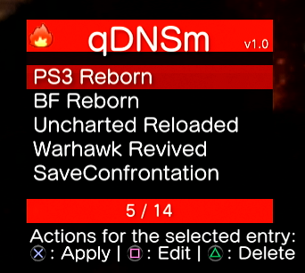

# qDNSm

A quick DNS switcher for the PlayStation 3.

Pick a DNS server from a list and qDNSm writes it into the console's network
configuration. It runs as a VSH plugin on the XMB, alongside webMAN, multiMAN and
the rest of the homebrew menu stack.



Works on **CFW** and **PS3HEN**, on CEX, PEX, D-PEX and DEX-mode consoles.

---

## The thing you have to know

**qDNSm writes the DNS settings. The console still has to build a new connection
to apply them.**

So after picking a server you still need to, once:

> Settings → Network → Internet Connection Settings →
> **Disable Internet Connection** → **Enable Internet Connection**

Both halves. The console only reads its DNS configuration while it is building a
connection.

**Also make sure Set Manually is selected** — in automatic mode the console takes
its DNS from DHCP and ignores what qDNSm wrote.

---

## Requirements

- PS3 with CFW **or** PS3HEN (on OFW/HFW)
- The SPRX loaded at boot via `boot_plugins.txt`

---

## Installing

### With the installer (recommended)

`qDNSm-Installer.pkg` installs the plugin for you. Install it like any other
package, launch **qDNSm installer** from the XMB, and it will:

- copy `qDNSm.sprx` to `/dev_hdd0/plugins/qDNSm.sprx`
- add it to `/dev_hdd0/boot_plugins.txt`
- offer to uninstall later, which removes both again
- offer to reboot when it's done

Pick **Yes** to install or **No** to uninstall, then let it reboot. Once it has
run you can delete the installer itself — nothing else depends on it.

### Manually

qDNSm is loaded as a boot plugin. Put the SPRX somewhere and point
`boot_plugins.txt` at it.

```
/dev_hdd0/plugins/qDNSm.sprx
```

Then create `/dev_hdd0/boot_plugins.txt` if it does not exist, containing:

```
/dev_hdd0/plugins/qDNSm.sprx
```

and reboot.

> **Note the location.** The file is `/dev_hdd0/boot_plugins.txt`, at the root of
> the HDD — *not* inside `/dev_hdd0/plugins/`. If you previously installed
> qDNSm by hand and have a copy in the plugins folder, it is doing nothing; move
> it to the root.

Some launchers manage `boot_plugins.txt` for you — if you use one, add the path
there instead of editing the file by hand.

### A note on boot_plugins.txt

Loading a SPRX at boot through `boot_plugins.txt` is a **CFW / HEN** feature. It
is not an RPCS3 feature — RPCS3's XMB is an HLE reimplementation and will not act
on the file. A qDNSm install looks identical on RPCS3 and on hardware but only
loads on hardware.

### Config file

The server list lives in `qDNSm.ini`, created next to wherever the SPRX is
loaded from (normally `/dev_hdd0/plugins/`). It is written when you add or remove
a server and read on launch. Delete it and qDNSm rebuilds the defaults.

---

## Using it

To open the menu while in the XMB you need to press R1 + R2 + R3 at the same time.
You can be holding down each of these buttons so triggering the menu open is pretty relaxed.

The menu lists every server in your config. Selecting one applies it.

- **Square** — edit the highlighted server
- **Triangle** — delete the highlighted server
- **Circle** — back
- **Add new DNS server** — add your own name and up to two IPs

Under **qDNSm options**:

| option | what it does |
|---|---|
| Secondary DNS | the secondary resolver address, or "Not set" |
| Startup notification | show a notification when the plugin loads |
| How to use | the same instructions as above, in-app |
| About | version and credit |
| Restore defaults | reset the server list to the shipped list |

---

## Building from source

### The plugin

Requires Visual Studio 2013+ and the Sony PS3 SDK (4.75 or newer) with the Visual
Studio integration installed.

Three directories under `vendor/` are deliberately **not** committed and have to
be restored before the plugin will build:

| directory | size | why |
|---|---|---|
| `vendor/PSL1GHT` | 17M | compiler and runtime sources |
| `vendor/securetool` | 1.6M | Sony signing binaries |
| `vendor/scetool` | 232K | signing tool and its key set |

They are large, binary and each obtainable from its own project, so carrying them
in the repository isn't worth it. Everything else the plugin links against —
`vendor/VirtualShell`, `vendor/sysutil` — is committed.

`vendor/VirtualShell` matters most: it is the interface layer this project is
built on, and a fresh clone will not compile without it.

Build configuration: **`Release | PS3`**

Output lands in:

```
bin/Release-PS3/qDNSm.prx     raw linked module, not deployed
bin/Release-PS3/qDNSm.sprx    signed — this is what you install
```

Signing happens automatically in the post-build step. See
[`docs/SIGNING.md`](docs/SIGNING.md) for how the key set is
chosen and why a single signed file covers both CFW and HEN.

### The installer

The installer is a separate PPU EXEC EBOOT under `installer_src/`, built with
PSL1GHT rather than the SDK, so it needs Docker rather than Visual Studio:

```bash
docker run --rm -v "$PWD:/work" ps3dev/ps3dev:submodules bash -lc \
  'export PSL1GHT=/usr/local/ps3dev PS3DEV=/usr/local/ps3dev && cd /work/installer_src && make pkg'
```

Build the plugin first — the packaging step copies the SPRX in, so a stale plugin
will be packaged with no warning.

To **repackage** after building either binary, without rebuilding anything:

```bat
package-installer.bat
```

That takes `bin\Release-PS3\qDNSm.sprx` and
`bin\Release-PS3\installer\EBOOT.BIN` as they are and puts them in
`bin\Release-PS3\qDNSm-Installer.pkg`. It needs Python 3 and nothing else.

See [`installer_src/README.md`](installer_src/README.md) for details.

---

## Credits

qDNSm is built on **[RouLetteVshMenu](https://github.com/TheRouletteBoi/RouLetteVshMenu)
by [TheRouletteBoi](https://github.com/TheRouletteBoi)** — the VSH menu, SPRX
loader and mod-menu framework this project started from, and the source of the
`VirtualShell` interface layer vendored under `vendor/`.

MIT licensed, © 2022 TheRouletteBoi.

Other components — `PSL1GHT`, `scetool` and `securetool` (restored separately, see
Building) and `vendor/sysutil` — come from the Sony PS3 SDK.

qDNSm itself: © 2026 Tha_14.

See [`LICENSE`](LICENSE).
